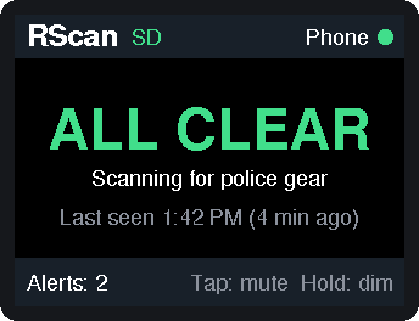
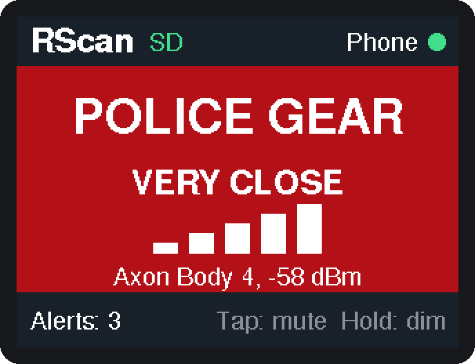
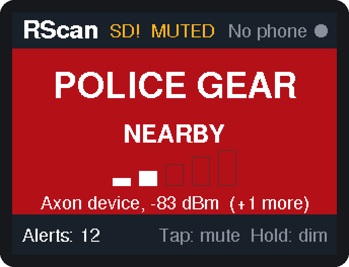
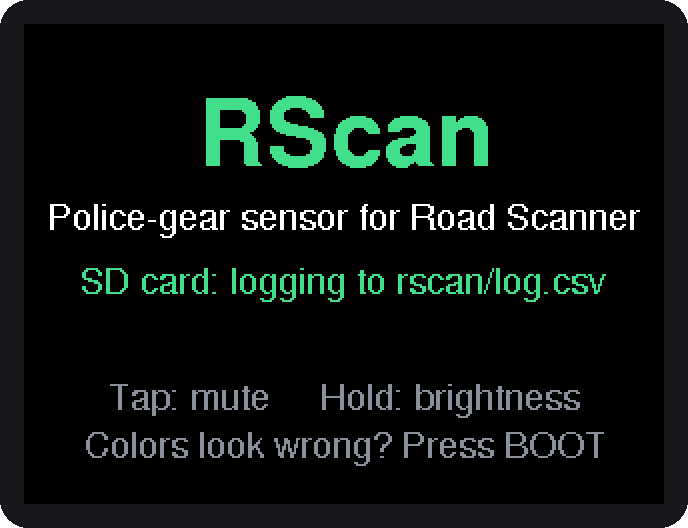

# Road Scanner for iPhone

Spoken alerts for mapped speed and license-plate (ALPR / Flock) cameras, plus police-gear alerts from a small ESP32 sensor. Alerts play through CarPlay or your car's Bluetooth the same way navigation directions do, so you never have to look at the phone.

**Features**

- **Camera alerts:** "Flock camera ahead, 600 feet." Uses OpenStreetMap / DeFlock camera data, saved on the phone so it works without signal.
- **Map tab:** the cameras around you, color-coded by type, with a wedge showing which way each one points.
- **Police-gear sensor:** an ESP32 "Cheap Yellow Display" in the car listens for Axon equipment (body cams, Tasers, in-car systems), shows it on its own screen, and alerts the phone.
- **SD card log:** the sensor saves every detection with date and time to a CSV file. A settings file on the card lets you change beeps, timing, and what it watches for.
- **Tests:** **Test voice** checks the car audio, and **Test sensor speaker** makes the board beep.
- **No Mac needed:** GitHub builds the app and the firmware on every push and publishes both as a Release.

**What's in this folder**

| Path | What it is |
|---|---|
| `RoadScanner/` | The iPhone app (SwiftUI) |
| `project.yml` | Project recipe the cloud build turns into an Xcode project |
| `.github/workflows/build-ipa.yml` | Builds the app on a GitHub cloud Mac (so you don't need one), plus the sensor firmware |
| `esp32/RScanSensor/` | PlatformIO project for the police sensor, an ESP32-2432S028R "Cheap Yellow Display": detects Axon gear, shows it on screen, logs it to the SD card, and alerts the phone |
| `docs/images/` | Screenshots used in this README |

## Screenshots

### Police sensor (ESP32 Cheap Yellow Display)

| Scanning, all clear | Police gear very close |
|---|---|
|  |  |
| **Muted, phone not connected, SD card error** | **Start-up** |
|  |  |

*Rendered at 2× from the firmware's own drawing code and fonts. Colors on the real panel vary a little between boards.*

---

## 1. Build the app on GitHub (no Mac needed)

1. Create a new repository on GitHub. Public is easiest: GitHub's Mac build machines are free for public repos. Private works too, but uses your monthly free build minutes faster.
2. Upload **everything in this folder**, including the hidden `.github` folder. The simplest way is [GitHub Desktop](https://desktop.github.com): clone your empty repo, copy these files into it, then commit and push.
3. Open the repo's **Actions** tab. The **Build app and firmware** run starts automatically on every push and takes about 5–10 minutes. You can also start it by hand with **Run workflow**.
4. When it finishes with a green check, open your repo's **Releases** page (`https://github.com/<you>/<repo>/releases/latest`, also linked on the right side of the repo's main page). Download **RoadScanner.ipa**. It's a plain file, not a zip, and you don't need to sign in. The same release has **rscan-cyd-factory.bin**, the sensor firmware built from the same code (see section 4).

**Check you've got the right build:** after installing, the bottom of the Scanner tab says "Version 1.0 (build N, abc1234)". N matches the release name ("Build N"), and there are **Scanner** and **Map** tabs at the bottom of the screen. If that line is missing, an old `.ipa` was installed.

If the build fails, open the failed step, copy the red error lines, and send them to Claude to fix.

## 2. Install it on your iPhone from Windows (free Apple ID)

1. Install **iTunes from Apple's website** (not the Microsoft Store version) and **[iloader](https://github.com/nab138/iloader)** (from its Releases page).
2. Plug your iPhone into the PC with a cable and tap **Trust** on the phone if it asks.
3. Open iloader and sign in with your Apple ID. A second Apple ID is a good idea (see the note below); it must have been signed in on an iPhone at least once.
4. Choose **Import any IPA**, pick `RoadScanner.ipa`, and let it install.
5. On the iPhone:
   - **Settings > General > VPN & Device Management**: tap your Apple ID and tap **Trust**.
   - If iOS says Developer Mode is required: **Settings > Privacy & Security > Developer Mode**, turn it on, and restart the phone.

**Every 7 days** the free signature expires and the app stops opening. Install the latest `RoadScanner.ipa` again **over the existing app**. Don't delete the app first, or you'll lose your saved cameras and settings.

**Why iloader and not Sideloadly:** since late October 2026, Apple's sign-in check rejects free sideloading tools, which shows up as `Login failed (-80046)` in Sideloadly. iloader 2.4.0 and later work around it by using a community-run sign-in server, which is why a second Apple ID is safer. Sideloadly works the same way once it ships a fix. Don't keep retrying a failing login with your main Apple ID; repeated failures can lock it temporarily.

**Updating:** push your changes, wait for the green check, download the new `RoadScanner.ipa` from the latest Release, and install it over the old one.

## 3. Use it

1. Open Road Scanner and tap **Start scanning**. Allow location (**While Using** is enough) and Bluetooth.
2. The first GPS fix downloads every mapped camera within 20 km (about 12 miles) and saves it on the phone. Do this once at home on Wi-Fi. After that it re-downloads automatically when you've driven about 10 km away, and keeps working with no signal.
3. Connect to CarPlay and tap **Test voice**. You should hear it through the car speakers.
4. Switch to Maps or music. Road Scanner keeps running in the background (you'll see the blue location indicator). **Don't swipe it away** in the app switcher, or it stops.

What you'll hear:
- **Cameras:** "Flock camera ahead, 600 feet." Cameras that are already behind you stay quiet. Each camera alerts once per pass.
- **Police gear:** "Police equipment close." Requires the ESP32 sensor below.

**Settings:** the alert distance (0.1, ¼ or ½ mile), voice on/off, and ESP32 sensor on/off. **Test voice** checks the phone's audio through the car. **Test sensor speaker** makes the ESP32 board play three rising tones and show "Speaker test" on its screen, even when the board is muted. It needs the sensor connected and running the current firmware.

**Map tab:** shows the downloaded cameras around you: orange for plate readers (Flock/ALPR), red for speed cameras. A shaded wedge shows which way a camera points, when mappers recorded it. While scanning, a blue circle shows your alert distance. Tap a camera to see what it is, how far away it is, which way it faces, and its OpenStreetMap entry. When you're not scanning, scroll anywhere and tap **Search here** to load the cameras for that area.

## 4. Set up the police sensor (ESP32 "Cheap Yellow Display")

iPhones hide other devices' Bluetooth addresses from apps, so the phone can't spot Axon gear by itself. The sensor is an **ESP32-2432S028R**, the 2.8" touchscreen board often called the "Cheap Yellow Display" (CYD). It sits in the car, does the scanning, shows what it finds on its own screen, and sends alerts to the app.

**You need** the board, the micro-USB cable it comes with, and a USB car charger. A microSD card (any size up to 32 GB, formatted FAT32) is optional.

### Flash it with PlatformIO (VS Code on Windows)

1. Install [VS Code](https://code.visualstudio.com), then the **PlatformIO IDE** extension (Extensions panel, search "PlatformIO").
2. **File > Open Folder…** and pick `esp32/RScanSensor` (the folder with `platformio.ini`, not the whole repo).
3. Click the **✓ Build** button in the blue status bar at the bottom. The first build downloads the ESP32 toolchain and libraries (several hundred MB, and it needs about 4 GB of free disk space once unpacked), so give it a while. Every version is pinned in `platformio.ini`, so you get exactly what was tested.
4. Plug in the board and click **→ Upload**. If it stalls at "Connecting…", hold the **BOOT** button on the back of the board until the upload starts.
5. Optional: click the **plug icon (Serial Monitor)** to watch detections at 115200 baud.

**If no COM port shows up**, Windows needs the board's USB driver (the CH340 or CP210x chip next to the USB port). Install the driver for whichever chip yours has, then replug the board.

**No-install alternative:** flash `esp32/RScanSensor/prebuilt/rscan-cyd-factory.bin` (or the **RScan-firmware** artifact from the GitHub build) from Chrome or Edge at [espressif.github.io/esptool-js](https://espressif.github.io/esptool-js/). Click **Connect**, pick the board's port, set the flash address to **0x0**, choose the file, and click **Program**.

### SD card (optional)

Put a FAT32 microSD card in the slot before powering on. The board creates a `rscan` folder on it containing:

- **`log.csv`:** one row per detection: date, time, MAC address, signal strength, device name. It opens in Excel or Google Sheets. Dates and times come from your iPhone, which sends the time when the app connects. Before the phone has connected, rows just show seconds since power-on. When the log reaches 4 MB it's renamed `log-old.csv` and a new one starts.
- **`config.txt`:** settings you can edit on your PC: beep pitch and count, how long a device counts as "still here", how soon the same device can alert again, screen rotation, logging on/off, and which Bluetooth prefixes to watch for. Every line is explained inside the file. A copy is in `esp32/RScanSensor/sd-card/rscan/` if you want to prepare a card in advance.

Restart the board (press **RST** or replug) after editing `config.txt`. If a line has a mistake, the start-up screen says how many lines were ignored, and the Serial Monitor says which ones and why. Everything else keeps working.

The header shows a green **SD** while logging, or an amber **SD!** if a write failed (card full or removed).

### Using it

| Screen | Meaning |
|---|---|
| Green **ALL CLEAR** | Scanning, no police gear in range. Shows when gear was last seen, e.g. "Last seen 1:42 PM (4 min ago)". |
| Red **POLICE GEAR** | Axon gear in range. Live signal bars, how close it is, and how many devices. The red LED on the back lights too. |
| **Phone** dot (top right) | Green when the iPhone app is connected. |

| Control | Action |
|---|---|
| Tap the screen | Mute or unmute the beeps |
| Hold the screen ~1 s | Cycle brightness 100% → 50% → 20%, handy at night |
| **BOOT** button | Fix the colors if the screen looks inverted (some board revisions, usually the ones with both micro-USB and USB-C) |

All three settings are remembered after power-off.

**Optional speaker:** the board has a 2-pin **SPEAK** connector (1.25 mm). Plug in a small 8 Ω speaker and it beeps on each new detection (three beeps by default; change it in `config.txt`). Without one, the screen and phone still alert. To check the speaker, tap **Test sensor speaker** in the app.

### Code layout

| File | What it does |
|---|---|
| `src/main.cpp` | Start-up, the main loop, touch, BOOT button, beeps, LED |
| `src/ble_link.cpp` | Bluetooth scanning and the link to the phone (including the time sync) |
| `src/screen.cpp` | Everything drawn on the display |
| `src/sd_storage.cpp` | SD card mounting, `config.txt`, and `log.csv` |
| `src/text_utils.cpp` | Config parsing and log/message formatting (unit-tested in `host_tests/`) |
| `include/config.h` | Board pins and the Bluetooth UUIDs shared with the app |

On this board the display and the SD card each use one of the ESP32's two hardware SPI buses, so the touch controller runs in software (XPT2046_Bitbang_Slim). That's the community-standard way to use all three at once.

---

## Limits worth knowing

- **Coverage:** camera locations come from OpenStreetMap volunteers (the DeFlock project), so coverage is only as good as local mapping.
- **Nevada:** state law bans red-light and speed cameras, so around Las Vegas you'll mostly get plate-reader alerts. Speed cameras matter when you drive into other states.
- **Police gear range:** Bluetooth reaches roughly tens of meters. "Police equipment" means an officer's gear is close by, not that a speed trap is ahead. Not every officer's gear broadcasts.
- **Mounting the sensor:** put it where it doesn't block your view of the road, and check the windshield-mount rules for any state you drive through. The phone voice and beeps are enough while driving, so you don't need to watch the screen.
- **CarPlay screen:** the app plays audio only and doesn't appear on the CarPlay screen. Putting it there would need a paid developer account and Apple's approval of a CarPlay entitlement.
- **Apple Maps routes:** iOS doesn't let other apps see the route you're navigating in Apple Maps, so Road Scanner alerts on every mapped camera around you, not just the ones on your route.
- **Driving:** set things up before you drive. The voice is there so you don't have to touch the phone.

## Troubleshooting

| Problem | Fix |
|---|---|
| No **Map** tab, or no version line at the bottom of the Scanner tab | An old `.ipa` got installed. Download `RoadScanner.ipa` from the **latest Release** (not an old download or an old Actions run), install it, and check the build number matches the release. |
| Sideloadly: `Login failed (-80046)` | Apple-side change in October 2026. Use iloader (section 2) until Sideloadly ships a fix. |
| PlatformIO: `MissingPackageManifestError` | A download got cut off. Close VS Code, delete the `platforms`, `packages`, `tools` and `.cache` folders in `C:\Users\<you>\.platformio` (leave `penv`), reopen, wait for setup to finish, then Build. |
| "ESP32 sensor: Looking for sensor…" never connects | Make sure the board is powered and shows its start-up screen, the app's ESP32 sensor switch is on, and Bluetooth is allowed for Road Scanner in iPhone Settings. |
| **Test sensor speaker** is greyed out | The sensor isn't connected, or it's running older firmware. Flash `rscan-cyd-factory.bin` from the latest Release. |
| The sensor screen's colors look inverted | Press the board's **BOOT** button once. It remembers the setting. |
| GitHub build failed | Open the failed step, copy the red error lines, and send them to Claude. |
